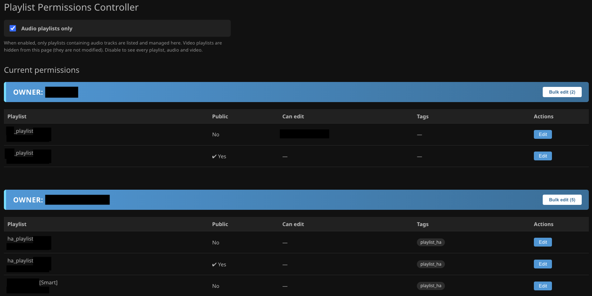
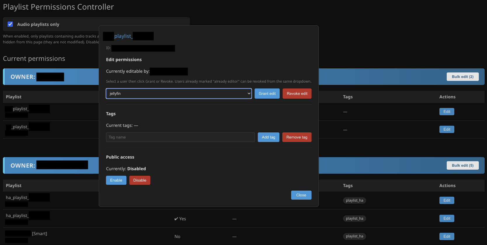
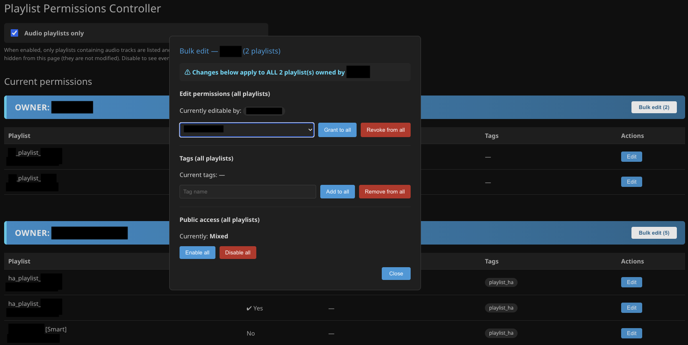

# Playlist Permissions Controller

A Jellyfin plugin to manage playlist edit permissions, tags, and public access — from the Jellyfin dashboard, with full admin control.

Built for **Jellyfin 12.2** (.NET 10).

> ### ⚠️ AI Disclosure
>
> This plugin was developed with substantial assistance from AI.
> The majority of the code was generated through an iterative conversational process,
> with the human author providing specifications, testing, and bug reports against a
> live Jellyfin 12.2 instance. The plugin is functional and tested, but the code has
> not been independently reviewed by a human developer. Please read the source or ask
> someone you trust to review it before installing on a production server.

## Screenshots

### Permissions overview



### Editing a single playlist



### Bulk editing an owner's playlists



## Features

- **Per-user edit permissions** — grant or revoke the `CanEdit` flag on any playlist for any user
- **Tag management** — add or remove tags on a single playlist or across every playlist owned by a user
- **Public access toggle** — enable or disable "Allow public access" (OpenAccess) on a playlist
- **Bulk operations** — apply permission, tag, or access changes to all playlists owned by a specific user in one click
- **Permissions overview** — see every playlist grouped by owner, with current editors, tags, and public access status at a glance
- **Admin-only** — every operation requires an authenticated admin account (Jellyfin's `RequiresElevation` policy)

## Requirements

- Jellyfin **12.2** or later
- Admin account on the Jellyfin server

## Installation

### Via the plugin repository (recommended)

1. In Jellyfin, go to **Dashboard → Plugins → Repositories**
2. Click **+** and add the following URL:
   ```
   https://raw.githubusercontent.com/I-G-1-1/jellyfin-plugin-playlist-permissions/main/manifest.json
   ```
3. Save, then go to **Dashboard → Plugins → Catalog**
4. Find **Playlist Permissions Controller** and click **Install**
5. Restart Jellyfin when prompted

### Manual installation

1. Download the latest release zip from the [Releases page](https://github.com/I-G-1-1/jellyfin-plugin-playlist-permissions/releases)
2. Extract it into your Jellyfin plugins folder:
   ```
   /var/lib/jellyfin/plugins/Playlist Permissions Controller_<version>/
   ```
   On Windows: `%LOCALAPPDATA%\jellyfin\plugins\Playlist Permissions Controller_<version>\`
3. Restart Jellyfin

## Usage

Once installed, open **Dashboard → Plugins → Playlist Permissions Controller** (or use the sidebar entry).

### Viewing permissions

The main page lists all playlists, grouped by owner. Each row shows:

| Column | Meaning |
|---|---|
| **Playlist** | Playlist name and ID prefix |
| **Public** | Whether the playlist has "Allow public access" enabled |
| **Can edit** | Users with edit permission (other than the owner) |
| **Tags** | Tags currently applied to the playlist |
| **Actions** | Edit button for per-playlist changes |

### Editing a single playlist

Click **Edit** on any row to open a dialog with three sections:

- **Edit permissions** — select a user from the dropdown, then click **Grant edit** or **Revoke edit**. Users who already have edit access are marked *"already editor"* in the list so you can revoke them easily.
- **Tags** — type a tag name, then click **Add tag** or **Remove tag**.
- **Public access** — click **Enable** or **Disable**.

Changes apply immediately, with a full-screen spinner while the server confirms the update.

### Bulk editing an owner's playlists

Each owner section has a **Bulk edit (N)** button in its header, where N is the number of playlists that owner has. Clicking it opens a dialog where changes apply to **every playlist owned by that user** at once:

- Grant or revoke edit access for a user across all playlists
- Add or remove a tag across all playlists
- Enable or disable public access across all playlists

Confirm dialogs appear before bulk actions that affect many playlists.

### Audio-only mode

At the top of the page there's a checkbox labelled **Audio playlists only**. When enabled, video playlists are hidden from the plugin UI (they are not modified). Disable it to see every playlist.

This setting saves instantly when toggled.

## Permissions model

The plugin reads and writes the standard Jellyfin playlist properties:

- **Owner** — the user who created the playlist (`OwnerUserId`)
- **Shares** — per-user permissions with a `CanEdit` flag
- **OpenAccess** — the "Allow public access" flag
- **Tags** — the item metadata tags array

All changes go through Jellyfin's library manager, so they propagate to the database and the Jellyfin UI immediately.

## Building from source

### Prerequisites

- .NET 10 SDK
- Jellyfin 12.2 or later running (for testing)

On Debian/Ubuntu:

```bash
wget https://packages.microsoft.com/config/debian/12/packages-microsoft-prod.deb -O packages-microsoft-prod.deb
sudo dpkg -i packages-microsoft-prod.deb
rm packages-microsoft-prod.deb
sudo apt update
sudo apt install dotnet-sdk-10.0
```

### Build

From the project root:

```bash
dotnet publish -c Release -o ./publish
```

The compiled plugin is at `publish/Jellyfin.Plugin.PlaylistPermissions.dll`.

### Install manually

```bash
DEST="/var/lib/jellyfin/plugins/PlaylistPermissions"
sudo mkdir -p "$DEST"
sudo cp publish/Jellyfin.Plugin.PlaylistPermissions.dll "$DEST/"
sudo cp meta.json "$DEST/"
sudo chown -R jellyfin:jellyfin "$DEST"
sudo systemctl restart jellyfin
```

## Project structure

```
source/
├── Jellyfin.Plugin.PlaylistPermissions.csproj
├── Plugin.cs                       # Plugin entry point
├── ServiceRegistrator.cs           # DI registration
├── meta.json                       # Plugin manifest (Jellyfin)
├── Api/
│   └── PlaylistPermissionsController.cs   # REST endpoints
├── Configuration/
│   ├── PluginConfiguration.cs
│   ├── configPage.html             # Dashboard UI
│   └── configPage.js
├── Models/
│   └── Dto.cs                      # Request/response types
└── Services/
    └── PlaylistPermissionService.cs       # Core logic
```

## REST API

All endpoints require an admin API key or admin JWT:

```
Authorization: MediaBrowser Token=<ADMIN_API_KEY>
```

| Method | Endpoint | Body |
|---|---|---|
| GET | `/Plugins/PlaylistPermissions/Permissions` | — |
| POST | `/Plugins/PlaylistPermissions/Permission` | `{"TargetUserId":"...","PlaylistId":"...","Revoke":false}` |
| POST | `/Plugins/PlaylistPermissions/Tag` | `{"PlaylistId":"...","Tag":"...","Add":true}` |
| POST | `/Plugins/PlaylistPermissions/TagAll` | `{"OwnerUserId":"...","Tag":"...","Add":true}` |
| POST | `/Plugins/PlaylistPermissions/OpenAccess` | `{"PlaylistId":"...","Enable":true}` |
| POST | `/Plugins/PlaylistPermissions/Logout/{userId}` | — |

Playlist IDs accept a full GUID, a prefix, or the exact playlist name.

## License

MIT — see [LICENSE](LICENSE) for details.

## Credits

Inspired by the original `JFPllstAccssCntrll.py` script, reimplemented as a native Jellyfin plugin.

## Disclaimer of Liability

This plugin modifies Jellyfin playlist metadata, including user permissions,
tags, and public access flags. While it uses Jellyfin's own library manager
APIs and has been tested against a live server, **no software is guaranteed
to be free of defects**.

By installing and using this plugin, you acknowledge and agree that:

- The author provides this software **"as is"**, without warranty of any kind,
  express or implied, including but not limited to the warranties of
  merchantability, fitness for a particular purpose, and non-infringement.
- The author is **not liable** for any claim, damages, or other liability —
  whether in an action of contract, tort, or otherwise — arising from, out of,
  or in connection with the software or its use.
- This includes, without limitation, **loss of data, corruption of playlist
  metadata, loss of user permissions, unintended exposure of playlists through
  the "public access" feature, service interruptions, or any other direct,
  indirect, incidental, special, exemplary, or consequential damages**.
- **You are responsible** for testing this plugin in a non-production
  environment before deploying it to a server that holds data you care about.
- **You are responsible** for maintaining backups of your Jellyfin
  configuration and database. The default location is
  `/var/lib/jellyfin/data/` (Linux) or `%LOCALAPPDATA%\jellyfin\data\` (Windows).
- **You are responsible** for reviewing the source code — or having someone
  qualified review it on your behalf — if you need assurance about its
  behaviour before running it on a production system.

In short: the plugin is provided freely, it is used at your own risk, and the
author accepts no responsibility for any harm that may result from its use.
